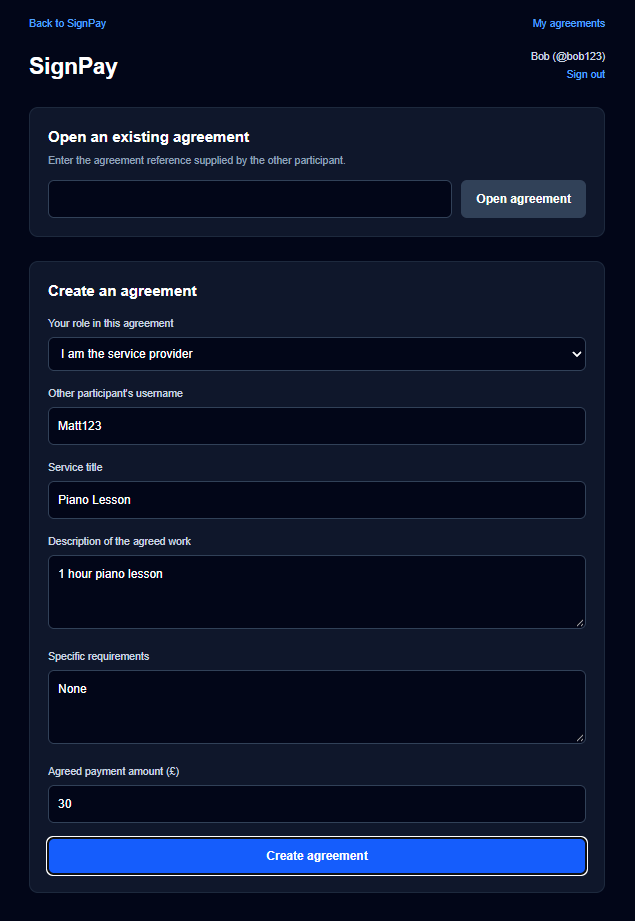
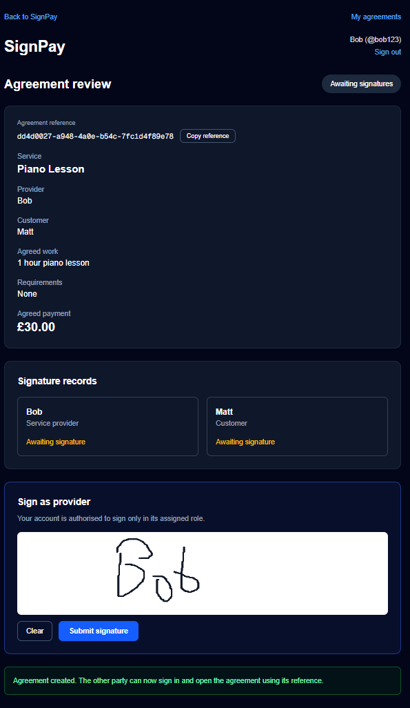

# SignPay

**AI-assisted assessment of service payment requests against digitally signed agreements, with PayPal invoice and payment integration.**

SignPay is a prototype developed for the PayPal AI Hackathon. It helps service providers and customers assess whether a payment request is consistent with the work and payment terms in their signed agreement.

The assessment is text-based. The provider submits a written completion statement and the customer may submit a written objection. The AI compares those statements with the original agreement. It does not verify physical work, analyse photographs or move money.

## Demonstration

The screenshots below document one complete test transaction in chronological order, from creating the agreement to PayPal confirming payment. Some screenshots show successive states of the same agreement.

### 1. Create the agreement



### 2. Agreement created, awaiting signatures



### 3. Provider signature recorded


### 4. Both participants have signed


### 5. Provider submits a payment request


### 6. Payment request sent to the customer


### 7. AI assessment and PayPal invoice


### 8. PayPal confirms payment


### 9. Completed agreement in the agreements list


### 10. Final completed agreement record


These screenshots are from a successful PayPal Sandbox test. The AI assessment is based on information submitted by the participants. It does not independently verify that the physical work took place.

## How it works

1. The provider and customer create an agreement recording the service, work, requirements and payment amount.
2. Both participants authenticate and sign the agreement.
3. The provider submits a payment request and written completion statement.
4. SignPay checks the requested amount against the agreed amount. The AI separately assesses the completion statement against the agreement.
5. After the initial assessment permits the request to proceed, the customer can submit a written objection.
6. If an objection is submitted, the AI assesses it against the agreement and the provider's completion statement.
7. Where the assessment workflow permits the request to proceed, SignPay creates and sends a PayPal invoice.
8. PayPal processes the payment. SignPay verifies the PayPal webhook before recording the invoice as paid and marking the payment request completed.

## Assessment outcomes

| Outcome | Meaning |
| --- | --- |
| `PROCEED` | No material discrepancy was identified in the submitted information. |
| `DISCREPANCY_IDENTIFIED` | The submitted information conflicts with an agreed term or requirement. |
| `HUMAN_REVIEW_REQUIRED` | The information is ambiguous, incomplete or insufficient for a reliable assessment. |

The requested payment amount is checked deterministically against the amount in the agreement. The AI cannot override this check.

## Architecture and technology

### Main application

- **Next.js and TypeScript** for the web application and server-side routes.
- **SQLite** for users, sessions, agreements, payment requests and audit events. The database is created automatically at `data/signpay.sqlite` on first run.
- **scrypt password hashing** and session controls for authentication.
- **SHA-256** to calculate an agreement integrity hash after both parties have signed.

### AI assessment agent

The separate `signpay-agent/` service uses:

- **Bun** as the JavaScript runtime.
- **Mastra** as the agent framework.
- **Astropods AI Gateway** for model access.
- **Claude Sonnet 4.6** as the configured default model.
- **Zod** for input and structured output validation.

The agent exposes an authenticated HTTP assessment endpoint to the main application. It assesses consistency with the agreement; it does not verify physical completion or move money.

### PayPal

SignPay uses the PayPal Invoicing API to create and send invoices. PayPal handles the payment itself. A verified PayPal webhook records the payment confirmation.

The integration has been tested using PayPal Sandbox accounts. Sandbox transactions are test transactions and do not transfer real money.

## Security controls

The prototype includes:

- Passwords stored as salted scrypt hashes, not plaintext.
- Opaque random session tokens, with token hashes stored in the database and an HTTP-only, SameSite cookie.
- Agreement access restricted to authenticated participants.
- Server-side participant and role checks for signing and customer objections.
- Customer objections enabled only after the provider's payment request passes the initial AI assessment.
- Shared-key authentication between the application and the agent, using timing-safe comparison.
- Zod validation of agent input and structured output.
- User-supplied descriptions treated as untrusted data, not instructions that can change the agent's rules.
- Human review when an AI assessment is uncertain.
- PayPal webhook signature verification before payment status is updated.

These controls demonstrate security principles in a prototype. They do not constitute an independent security audit or certification.

## Limitations

- **Text-based assessment:** the prototype does not accept or analyse photographs or other visual evidence.
- **No physical verification:** the AI assesses consistency between submitted statements and the agreement. It cannot prove that work took place.
- **Human resolution:** uncertain cases require the parties to resolve the matter outside the automated assessment.
- **Payment processing:** PayPal, not the AI agent, handles invoicing and payment.
- **Prototype status:** this is a hackathon demonstration, not a production payment service.

## Project structure

```text
signpay/
├── src/                  # Next.js application and API routes
├── signpay-agent/        # AI assessment agent
├── public/               # Static application assets
├── .env.example          # Main application environment template
├── package.json
└── README.md
```

The agent has its own README. The blank root `.env.local` is included as a convenience for judges. Keep it blank in Git and never commit real credentials. Local databases are excluded from source control.

---

# Run SignPay locally

These instructions are intended for a judge setting up a fresh copy of the repository. They use PayPal Sandbox and local development services. No production credentials are required.

## Prerequisites

Install:

- **Node.js 24.x** and npm.
- **Bun**.
- **Astropods CLI**, with access to an Astropods account and AI Gateway.
- **Cloudflare Tunnel** (`cloudflared`) or another HTTPS tunnel, so PayPal can reach the local webhook during payment testing.
- A **PayPal Developer** account with a Sandbox Business account and a separate Sandbox Personal (buyer) account.

## 1. Clone the repository

```bash
git clone https://github.com/Matth161002/signpay.git
cd signpay
```

## 2. Install the main application

```bash
npm install
```

## 3. Configure the main application

Open the empty `.env.local` file already included in the repository. Use `.env.example` beside it as the template, and enter the following values:

| Variable | Value |
|---|---|
| `PAYPAL_CLIENT_ID` | Client ID from your PayPal Developer **Sandbox** application. |
| `PAYPAL_CLIENT_SECRET` | Secret from the same Sandbox application. |
| `PAYPAL_BUSINESS_EMAIL` | Email address of your PayPal Sandbox Business account. |
| `PAYPAL_WEBHOOK_ID` | ID of the Sandbox webhook created in step 6. |
| `SIGNPAY_AGENT_URL` | Local URL exposed by the running agent. The current local setup uses `http://localhost:3200`. |
| `SIGNPAY_AGENT_API_KEY` | A random shared secret of at least 32 characters. It must match the value configured in the Astropods project settings using `ast project configure`. |

Do not commit real credentials or share them. The committed `.env.example` contains placeholders only. Keep the tracked `.env.local` blank in Git.

## 4. Configure the AI assessment agent

Open a second terminal and enter the agent directory:

```powershell
Set-Location signpay-agent
```

Configure the agent's required secret:

```bash
ast login
ast project configure
```

When prompted, set `SIGNPAY_AGENT_API_KEY` to exactly the same random secret used in the root `.env.local`. Astropods stores this value in the local project configuration. You do not need to create `signpay-agent/.env` for this Astropods workflow.

Astropods automatically provides the AI Gateway development credentials when the agent starts. You do not need to supply `ASTRO_GATEWAY_URL` or `ASTRO_GATEWAY_API_KEY` yourself.

Start the agent:

```bash
ast project start
```

Keep this terminal running. Use the local agent URL reported by the Astropods CLI as `SIGNPAY_AGENT_URL` in the root `.env.local`. In the tested local setup, the URL was `http://localhost:3200`. If the CLI reports a different URL, use that instead.

The agent configuration and additional details are in [signpay-agent/README.md](signpay-agent/README.md).

## 5. Start the main application

Open a third terminal at the repository root, not inside `signpay-agent/`:

```bash
npm run dev
```

Keep this terminal running and open [http://localhost:3000](http://localhost:3000).

The SQLite database is created automatically in the root `data/` directory. No separate database server or database setup is required. The database is local to this copy of SignPay.

## 6. Configure the PayPal Sandbox webhook

PayPal must be able to reach the local application's webhook endpoint. Start a Cloudflare Quick Tunnel in another terminal:

```bash
cloudflared tunnel --url http://localhost:3000
```

On Windows, if you downloaded the executable rather than installing it on your PATH, run it from its download folder, for example:

```powershell
.\cloudflared.exe tunnel --url http://localhost:3000
```

Cloudflare will display a temporary public HTTPS URL, for example `https://example.trycloudflare.com`. **Copy that URL and append `/api/paypal/webhook`.** This complete address is the webhook URL you must enter in PayPal:

```text
https://example.trycloudflare.com/api/paypal/webhook
```

In the PayPal Developer Dashboard:

1. Open **Apps & Credentials** and select the **Sandbox** tab.
2. Open the same Sandbox REST application whose Client ID and Secret you entered in `.env.local`. The webhook must belong to this application.
3. Find its **Webhooks** section and select **Add Webhook**.
4. Paste the complete Cloudflare address ending in `/api/paypal/webhook` into the **Webhook URL** field. Do not enter `localhost` and do not omit the endpoint path.
5. Select the `INVOICING.INVOICE.PAID` event. This is the event SignPay uses to record a paid invoice.
6. Save the webhook. Copy the generated **Webhook ID** into `PAYPAL_WEBHOOK_ID` in the root `.env.local`. This is the webhook ID, not the application's Client ID or Secret.

Restart the Next.js development server after updating `.env.local` so the new webhook ID is loaded.

If the Quick Tunnel is restarted, its public URL may change. Update the webhook URL in the PayPal Developer Dashboard and update `PAYPAL_WEBHOOK_ID` if you create a replacement webhook.

After changing `.env.local`, restart the Next.js development server so it reloads the configuration.

## 7. Test the complete workflow

Use two separate browser sessions, for example a normal browser window and a private/incognito window, to represent the two participants.

1. Register or sign in as the provider and create an agreement.
2. Open the agreement as the customer in the second browser session and sign it.
3. Sign in as the provider and submit a payment request with a completion statement.
4. Sign in as the customer and submit an objection if testing that part of the workflow.
5. Where the assessment permits the request to proceed, check that SignPay creates a PayPal invoice.
6. Pay the invoice using the separate PayPal Sandbox Personal (buyer) account.
7. Check the agreement in SignPay. It should show the completed state and payment confirmation after the verified PayPal webhook has been received.

Use the Sandbox Business account as the invoice recipient and the Sandbox Personal account as the payer. Do not use live PayPal accounts or real payment credentials.

## Troubleshooting

- **Assessment service not configured:** check that `SIGNPAY_AGENT_API_KEY` is present in both environment configurations and that the values match. Check that `SIGNPAY_AGENT_URL` points to the running agent.
- **Agent unavailable:** check that the Astropods project is running and use the URL reported by its CLI.
- **PayPal business email not configured:** check `PAYPAL_BUSINESS_EMAIL` in the root `.env.local`, then restart Next.js.
- **Webhook not received:** check that the Cloudflare tunnel is running, that the PayPal webhook URL ends in `/api/paypal/webhook`, and that the Sandbox webhook ID in `.env.local` belongs to that webhook.
- **Agreement data missing after restarting:** the local SQLite database is stored in `data/signpay.sqlite`. Do not delete the `data/` directory if you want to retain local test data.

## Hackathon project

SignPay demonstrates how AI-assisted assessment can be combined with signed agreements, deterministic checks and payment infrastructure. Its central design principle is to keep the AI's role limited: it assesses information submitted by the participants, application logic enforces fixed agreement and payment checks, uncertain cases can be escalated, and PayPal remains responsible for processing payments.
